# Machine Learning-Based Network Intrusion Detection System

A research prototype for binary network-flow intrusion detection. It trains and benchmarks classifiers on CICIDS2017 flow data, then uses a Streamlit dashboard to score CICFlowMeter-compatible CSVs, display benign/attack probability estimates, and support threshold-based offline triage.

> **Scope:** The dashboard does not capture live packets, ingest PCAP files, or block network traffic. Its live-style feed and mitigation status are simulated. External testing also shows that the checked-in model does not generalize reliably to the evaluated CICIDS2018 infiltration flows; see [External evaluation](#external-evaluation-cicids2018).

## Problem statement

Network intrusion detection must distinguish malicious activity from ordinary traffic while limiting both missed attacks and false alarms. This project frames that task as binary classification:

- `0` — Benign
- `1` — Attack

The CICIDS2017 benchmark presents several practical challenges: benign traffic dominates the data, attack classes are highly imbalanced, flow statistics contain invalid values and duplicates, and a single accuracy score can hide weak attack detection.

## Solution and architecture

The workflow cleans flow records, creates a leakage-aware train/test split, benchmarks several classifiers, and exports model artifacts for the Streamlit app.

```mermaid
flowchart LR
    A[Eight CICIDS2017 flow CSVs] --> B[Clean headers, invalid values and duplicates]
    B --> C[77 flow features and binary labels]
    C --> D[Stratified 80/20 split]
    D --> E[Fit StandardScaler on training data only]
    E --> F[Compare Dummy, Logistic Regression, Random Forest and XGBoost]
    F --> G[Saved model, scaler and feature metadata]
    G --> H[Streamlit offline triage dashboard]
    H --> I[Batch CSV scoring, probabilities, threshold verdicts and CSV export]
```



### Data preparation and training

The notebook benchmark combines eight CICIDS2017 CSV captures. The recorded cleaning workflow:

1. Strips whitespace from column names.
2. Replaces `inf` and `-inf` with missing values, then removes invalid rows.
3. Removes duplicate flows and the redundant `Fwd Header Length.1` column.
4. Maps the 15 original labels to benign or attack and keeps 77 numeric model features.
5. Splits the cleaned data 80/20 using stratification by original label.
6. Fits `StandardScaler` on the training set and applies that scaler to the test set.

The resulting notebook dataset contains **2,520,798 flows**: 2,095,057 benign and 425,741 attack. The stratified split contains 2,016,638 training flows and 504,160 test flows.

The notebook benchmark and the saved dashboard model are different training runs. `notebooks/models.ipynb` evaluates XGBoost with 200 trees on the full cleaned benchmark. `src/train_and_export.py` is configured to export a 100-tree XGBoost model and a 50-tree Random Forest after sampling up to 20,000 benign rows per input file. The checked-in `models/xgb_model.joblib` is a 100-tree model. Do not attribute the notebook's 99.92% result to the checked-in artifact.

## CICIDS2017 benchmark results

The following results are from the notebook's **504,160-flow stratified holdout**. Attack precision, recall and macro F1 make the minority-class performance visible alongside accuracy.

| Model | Accuracy | Attack precision | Attack recall | Macro F1 | False positives | False negatives |
|---|---:|---:|---:|---:|---:|---:|
| Dummy (most frequent) | 83.11% | 0.00% | 0.00% | 0.4539 | 0 | 85,148 |
| Logistic Regression | 95.71% | 88.15% | 86.20% | 0.9230 | 9,863 | 11,753 |
| Random Forest (100 trees) | 99.90% | 99.69% | 99.70% | 0.9982 | 268 | 252 |
| **XGBoost (200 trees)** | **99.92%** | **99.67%** | **99.84%** | **0.9985** | **278** | **138** |

### Confusion matrix counts

Rows are actual classes; columns are predicted classes. The test set contains 419,012 benign flows and 85,148 attack flows.

| Model | True benign (TN) | Benign flagged as attack (FP) | Attack missed (FN) | Attack detected (TP) |
|---|---:|---:|---:|---:|
| Dummy | 419,012 | 0 | 85,148 | 0 |
| Logistic Regression | 409,149 | 9,863 | 11,753 | 73,395 |
| Random Forest (100 trees) | 418,744 | 268 | 252 | 84,896 |
| **XGBoost (200 trees)** | **418,734** | **278** | **138** | **85,010** |

At the notebook benchmark's default operating point, XGBoost gives the strongest attack recall and macro F1 of the compared models. Its false-positive rate is 278 / 419,012, or approximately **0.066%**.

## External evaluation: CICIDS2018

The saved 100-tree dashboard model and its scaler were evaluated unchanged on one official CSE-CIC-IDS2018 CICFlowMeter-V3 day file containing benign and infiltration traffic. The source CSV had 331,125 rows; after removing invalid rows and exact duplicate feature-vector/label rows, **288,027 flows** were scored. All 77 model inputs were mapped from the CICFlowMeter-V3 column names; the model and scaler were not retrained or refit.

At threshold **0.50**, the saved artifact achieved:

| Metric | Result |
|---|---:|
| Accuracy | 70.99% |
| Attack precision | 41.23% |
| Attack recall | 2.89% |
| Attack F1 | 5.41% |
| Macro F1 | 0.4414 |
| False-positive rate | 1.66% |
| ROC-AUC | 0.5807 |
| Average precision (AP) | 0.3897 |

External confusion matrix (actual rows, predicted columns):

|  | Predicted benign | Predicted attack |
|---|---:|---:|
| Actual benign | 202,093 | 3,403 |
| Actual attack | 80,144 | 2,387 |

This result indicates a substantial cross-dataset generalization gap for the saved model on this infiltration slice. Lowering the threshold to 0.05 increased recall to 25.65% but raised the false-positive rate to 10.09%; raising it reduced recall further. The threshold sweep is diagnostic only—the external test data was not used to select a production threshold. See the full [external evaluation report](reports/cse_cic_ids2018_external_evaluation.md) and [metrics JSON](reports/cse_cic_ids2018_external_evaluation.json).

Dataset sources: [CICIDS2017](https://www.unb.ca/cic/datasets/ids-2017.html) · [CSE-CIC-IDS2018](https://www.unb.ca/cic/datasets/ids-2018.html)

## Streamlit dashboard

The dashboard is intended for **offline triage and research demonstrations** on flow-feature CSVs. It supports:

- Batch XGBoost or Random Forest inference on CSVs with the required 77 features.
- Per-flow `P(Benign)` and `P(Attack)` estimates from the model's `predict_proba` output.
- An adjustable attack-probability threshold, prediction filtering, and audited CSV export.
- Inspection of a sample flow and the model's global feature-importance ranking.
- A simulated traffic feed populated from `data/sample_test_traffic.csv`.

The probability values are model estimates and have not been calibrated. The simulated feed generates timestamps and IP addresses; its “Blocked (iptables)” status does not execute firewall rules. The app scores flow-statistic CSVs and does not capture packets or parse PCAPs directly.

## Run the app

Python 3.12 is recommended; the dependency versions used for the checked-in artifacts are listed in [`requirements.txt`](requirements.txt).

```bash
git clone https://github.com/krish5S/Network-Intrusion-Detection-System-NIDS-.git
cd Network-Intrusion-Detection-System-NIDS-
python -m venv .venv
source .venv/bin/activate
python -m pip install -r requirements.txt
streamlit run app.py
```

On Windows, activate the environment with `.venv\Scripts\activate` before installing dependencies.

The repository includes the model artifacts and a small demo-flow CSV. Raw CICIDS captures are excluded from Git by `.gitignore`.

### Reproduce the external evaluation

Download the selected official CSV and run the saved-model evaluation script:

```bash
mkdir -p data/external
curl -L \
  'https://cse-cic-ids2018.s3.ca-central-1.amazonaws.com/Processed%20Traffic%20Data%20for%20ML%20Algorithms/Thursday-01-03-2018_TrafficForML_CICFlowMeter.csv' \
  -o data/external/Thursday-01-03-2018_TrafficForML_CICFlowMeter.csv
python src/evaluate_external.py
```

### Retrain and export artifacts

Place the eight raw CICIDS2017 CSV files in `data/` and run:

```bash
python src/train_and_export.py
```

The exporter reads every `*.csv` file in `data/`; move `sample_test_traffic.csv` out of that directory before retraining so the demo sample is not included in training.

## Project structure

```text
.
├── app.py                         # Streamlit offline triage dashboard
├── src/
│   ├── train_and_export.py        # Train and export compact app artifacts
│   └── evaluate_external.py       # Score external flow CSVs with saved artifacts
├── notebooks/
│   ├── 01_explore.ipynb           # Initial single-capture exploration
│   └── models.ipynb               # Full CICIDS2017 benchmark
├── models/                        # Saved XGBoost, Random Forest, scaler, metadata
├── data/sample_test_traffic.csv   # Small dashboard demo sample
├── reports/                       # External evaluation results
├── assets/                        # Dashboard screenshots
├── requirements.txt
└── run_frontend.sh
```

## Technology stack

Python · XGBoost · scikit-learn · pandas · NumPy · Streamlit · Plotly · joblib
